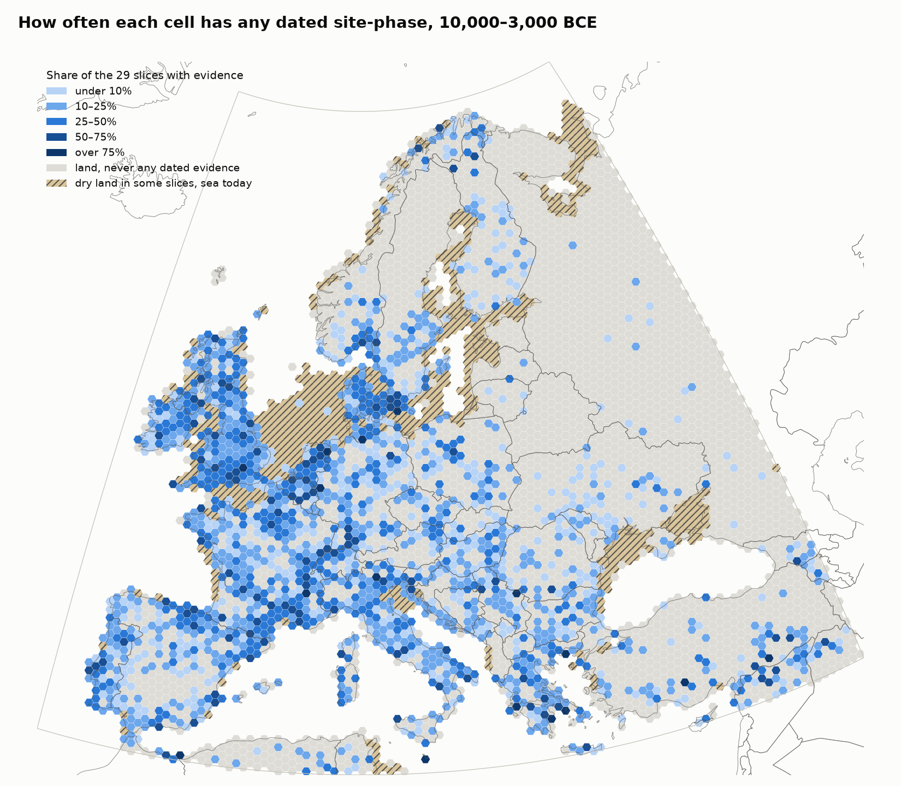
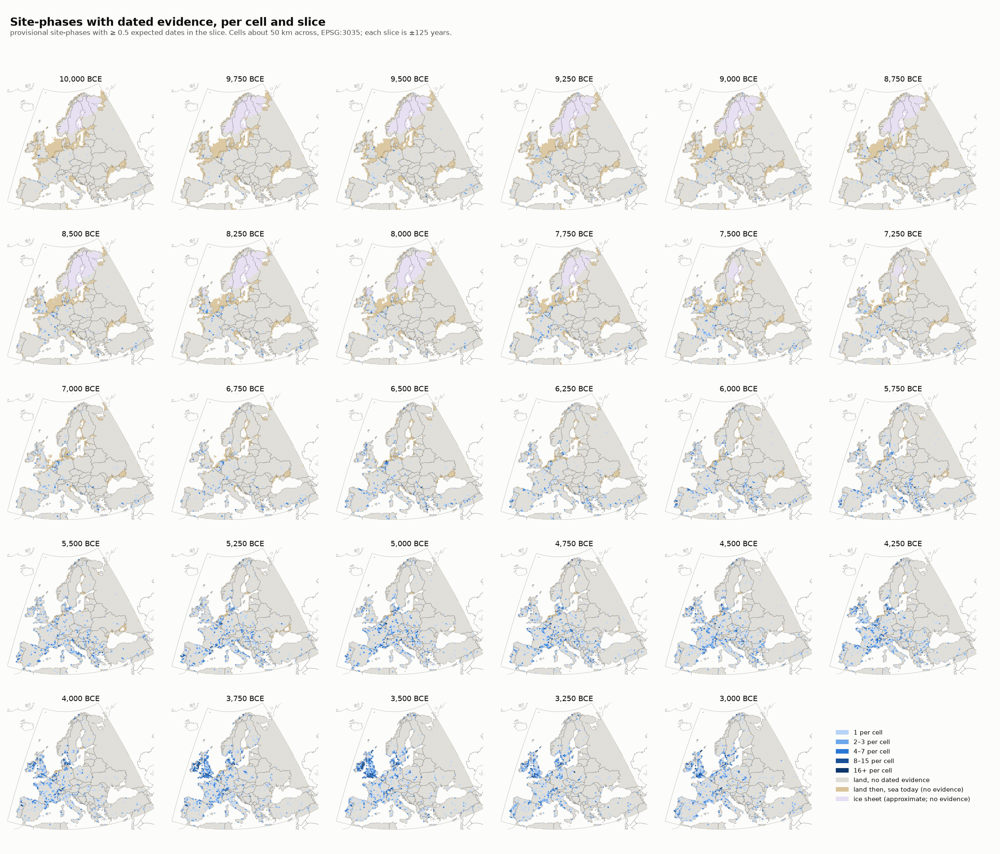
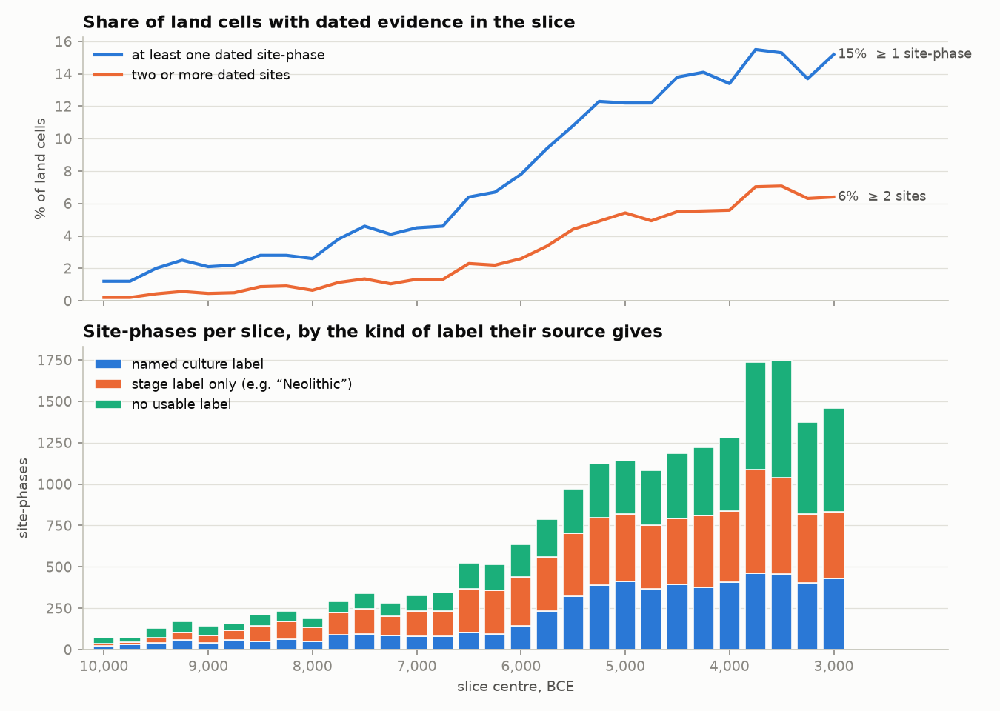

# Isostyle maps, Phase 1: data audit

*2026-11-12. Regenerate the numbers and maps with `.venv/bin/python -m isostyle audit`
(config: `isostyle/audit.toml`). The surfaces built afterwards use the game's grid and the eight keyframe slices instead; see `../METHODS.md`. Tables are in `tables.json`, per-cell counts in `gap_cells.csv.gz`.*

## Verdict

- **Dated sites:** good west of a line from the Oder to the Adriatic, thin in the Balkans and
  Scandinavia, and close to absent in the Baltic states, Belarus, Ukraine and Russia. In any one
  250-year slice, 1% (10,000 BCE) to 15% (3,000 BCE) of land cells hold a dated site-phase.
- **Attribute-level style data:** none of the five materials has open data that would support a
  continuous style surface. Each has a few regional patches. Everything else would have to be
  derived from culture labels, and only 29% of site-phases carry a named culture label.
- **What can be mapped honestly now:** evidence/gap surfaces, culture labels as one-hot traits
  (marked label-derived), and patch-wise style surfaces where the datasets in section 4 exist.

## 1. Setup used for this audit

| Item | Value | Why |
|---|---|---|
| Grid | 7,064 flat-topped hexagons, 50 km flat to flat (2,165 km²), EPSG:3035, centres inside 35–72°N, 12°W–45°E; 4,447 are land today | No grid was attached, so the stated default was built. The repo's game grid (0.5° lon/lat hexes) was not used: it is not equal-area. |
| Slices | 29, from 10,000 to 3,000 BCE every 250 years, each ±125 years | No list was attached. |
| Dates | The raw downloads `make settlements` already cached: XRONOS API dumps, p3k14c 2025.07, NeoNet Med v2, NeoNet Atl v1 | See section 2. |
| Calibration | IntCal20, full distribution on a 10-year grid; a date's contribution to a slice is the share of its distribution inside it | Marine and shell dates get no reservoir correction. |
| Site | Records with the same name and point; spellings folded as in `make settlements` | |
| Site-phase (provisional) | The dates of one site that carry the same set of source labels; unlabelled dates form one phase per site | The sources give no consistent phasing. **This needs your decision** (section 6). |
| "Present in a slice" | A site-phase with at least 0.5 expected dates in the slice | Counting threshold for the maps only. |

Unlike `make settlements`, nothing is dropped by site type, so graves, hoards and megaliths are in.

Counts: 238,667 XRONOS records, of which 20,315 have no coordinates, age or site name. After adding
what p3k14c and NeoNet have that XRONOS lacks, 193,613 records fall in the box; they reduce to
101,344 distinct dates at 20,476 sites. 38,880 dates have some probability inside the slices,
worth 36,184 expected dates. 9,407 site-phases lie mostly inside the window.

## 2. Site and radiocarbon datasets

"In hand" figures are expected dates inside the box and window, counted from the references each
XRONOS record cites; one date can count under several compilations. Coverage, fields and licences
of the upstream datasets come from a web check on 2026-11-12: **V** = landing page, paper or file
opened; **U** = from a search result or memory, not confirmed.

| Dataset | Coverage | Per record | Licence | In hand |
|---|---|---|---|---|
| **XRONOS** (Roe et al. 2025, doi:10.5334/jcaa.191) | Global aggregator; Europe as below | Site, type, country, coordinates, lab number, material, feature, period/typochronological labels, references | CC BY 4.0 on the site, but contributors "retain control over licensing"; no per-source table (V) | all XRONOS rows |
| **p3k14c** (Bird et al. 2022, doi:10.1038/s41597-022-01118-7) | Global; in our box strongest in Britain, central Europe, France | Lab id, age, material, taxa, coordinates ("scrubbed and fuzzed"), free-text Period, source. No culture field | CC0 per the repository check (V); the repo's own `SOURCES.md` here recorded CC BY for the article and none for the data file | 22,391 |
| **EUROEVOL** (Manning et al. 2016, doi:10.5334/joad.40) | 42.6–64.6°N, 10.5°W–24°E: PL, DE, AT, CH, FR, CZ, DK, SE, Benelux, GB, IE. Nothing for Iberia, Italy, the Balkans, Hungary or east of Poland. About 8000–4000 BP | Sites, phases (Culture, SubCulture, Period, SiteType only), dates; 45% of dates link to a phase. Fauna (>3M NISP) and archaeobotany in companion datasets. **No artefact attributes** (V) | Inconsistent: CC BY 3.0 on joad.40, CC0 on the fauna paper, unstated on the botany paper (V) | 9,185 |
| **NeoNet Med** (Huet et al. 2022, doi:10.5334/joad.87) | NW Mediterranean (Ebro, Rhône, Po), 9000–5000 BP; v1 2,506 dates, 526 sites | Site, Period, PhaseCode, lab code, age, material, coordinates, bibliography | CC BY 4.0 in the data paper; CC BY-SA on the Pisa repository | 914 with Atl |
| **NeoNet Atl** (Huet et al. 2024, doi:10.5334/joad.120) | PT, W Spain, SW France; 1,143 dates, 254 sites | Same fields | CC BY 4.0 (V) | |
| **RADON / RADON-B → Rado.NB** (Rinne et al. 2024) | Neolithic–Early Iron Age, central Europe and S Scandinavia | Culture, feature type, material, site | CC BY 3.0 (V) | 12,435 + 559 |
| **CalPal** (Weninger; 2020 mirror) | Europe-wide and Near East | Period, subperiod, culture, phase, locus, site type | **None stated** (V) | 21,260 |
| **14SEA** (Reingruber & Thissen 2017) | Anatolia, Aegean, C and E Balkans, S Carpathian basin; 10,000–3000 cal BC | Level/phase labels from reports | **All rights reserved; redistribution needs written permission** (V) | 348 |
| **BDA** (Perrin; doi:10.34847/nkl.dde9fnm8) | France and neighbours, Mesolithic–Neolithic; 4,909 sites, 6,649 occupations, 6,830 dates | Culture, phase, TPQ/TAQ, free-text flint/stone/pottery notes, presence flags. No structured attribute counts (V) | CC BY 4.0 (V) | 2,614 |
| **AIDA** (Palmisano et al., doi:10.5281/zenodo.6427045) | Italy; 4,629 dates, 1,050 sites | Site type and context; no culture column | CC BY 4.0 (V) | 2,020 |
| **Katsianis et al. 2020** (doi:10.5334/joad.65) | Greece; 3,159 dates, 353 sites | Cultural period, site phase, context; coordinates coarsened to ~500 m | CC BY 4.0 (V) | 1,012 |
| **Bevan et al. 2017**, **IRDD** (Chapple) | Britain and Ireland | Dates, site, some period labels | Bevan U; IRDD CC BY 4.0 (V) | 2,149; 1,636 |
| **Balsera et al. 2015** | Iberia | Dates, period | U | 1,625 |
| **PACEA / Vermeersch** | Palaeolithic to early Holocene Europe; Vermeersch v33 excludes dates younger than 9500 BP | Cultural attributions | None stated (V for Vermeersch) | 1,577 |
| **AgriChange** (doi:10.5281/zenodo.4541470) | NW Mediterranean to High Rhine, 5900–2000 cal BC; 3,690 dates | Reliability fields | CC BY 4.0 (V) | 172 |

Open compilations found but **not yet in hand** (candidates to add):

- LASOLES, Czech Republic (Tkáč & Kolář 2021, doi:10.5334/joad.85): 1,579 dates, 357 sites, with a cultures table; CC BY 4.0 (V).
- Sweeney, Harrison & Vander Linden 2021, Iberia (doi:10.17864/1947.000340): 6,343 dates; CC BY 4.0 (V).
- Pardo-Gordó et al. 2019, Iberia Mesolithic–Neolithic (doi:10.5334/joad.49); CC BY 4.0 (U).
- Hoebe et al. 2023, Low Countries Late Palaeolithic–Mesolithic, about 6,500 dates; repository not found (U).
- Trampota & Pajdla 2021 (doi:10.5281/zenodo.5768049): over 2,100 settlements in Czechia and neighbours, 4900–3300 BCE, pottery tradition per slice; CC BY 4.0. Labels only.
- c14bazAAR itself can fetch all of the above getters; most of its Europe-relevant sources already reach us through XRONOS.

**No open compilation was found** for Ukraine, Belarus, European Russia and the Caucasus
(Neolithic/Eneolithic), for the Baltic states, for Finland, or for the Mesolithic as such anywhere.
The Balkans rest on 14SEA (closed licence, frozen at 2017) and on CalPal (no licence). Not checked
at all: the XRONOS source list and the licences of BDA's online version, PACEA, Palmisano and Bevan 2017.

## 3. Gap maps

- `gap_site_phases.png`: site-phases per cell, 29 panels.
- `gap_dates.png`: expected radiocarbon dates per cell, 29 panels.
- `gap_culture_labels.png`: site-phases that carry a named culture label.
- `gap_coverage.png`: share of the 29 slices in which each cell has any evidence.
- `gap_timeline.png`: coverage and label kinds through time.

Grey is land with no dated evidence, sand is land that is sea today, lilac is the ice sheet. None of
these is a value.

| Slice (BCE) | Land cells | With ≥ 1 site-phase | With ≥ 2 sites | Expected dates | Site-phases | Drowned-since cells |
|---|---|---|---|---|---|---|
| 10,000 | 4,948 | 60 (1.2%) | 10 | 149 | 72 | 631 |
| 9,000 | 4,884 | 101 (2.1%) | 22 | 257 | 142 | 556 |
| 8,000 | 4,811 | 126 (2.6%) | 31 | 347 | 188 | 442 |
| 7,000 | 4,684 | 213 (4.5%) | 62 | 592 | 328 | 264 |
| 6,000 | 4,588 | 359 (7.8%) | 119 | 1,235 | 637 | 140 |
| 5,000 | 4,521 | 552 (12.2%) | 245 | 1,940 | 1,143 | 40 |
| 4,000 | 4,494 | 600 (13.4%) | 251 | 2,134 | 1,281 | 21 |
| 3,000 | 4,452 | 677 (15.2%) | 285 | 2,833 | 1,460 | 0 |

### Why the gaps are where they are

**Research intensity and data-sharing by modern country** is the largest effect. Density follows
borders, not geography:

| Region | Land cells | Sites | Expected dates | Dates per 1,000 km² | Cell-slices with evidence | Cells ever with evidence |
|---|---|---|---|---|---|---|
| Britain & Ireland | 182 | 1,767 | 6,993 | 17.8 | 27% | 97% |
| France & Benelux | 294 | 1,670 | 5,955 | 9.4 | 21% | 81% |
| Italy & Malta | 164 | 637 | 2,748 | 7.7 | 17% | 75% |
| Central Europe | 474 | 1,051 | 5,683 | 5.5 | 9% | 54% |
| Iberia | 294 | 964 | 3,380 | 5.3 | 13% | 65% |
| Balkans & Greece | 403 | 616 | 3,871 | 4.4 | 10% | 53% |
| Anatolia, Caucasus, Levant (part in box) | 508 | 269 | 3,400 | 3.1 | 5% | 22% |
| Nordic | 597 | 1,018 | 3,397 | 2.6 | 6% | 32% |
| Baltic states | 90 | 12 | 36 | 0.18 | 0.8% | 7% |
| Ukraine, Belarus, Russia | 1,322 | 106 | 314 | 0.11 | 0.5% | 6% |

The UK has 160 times the date density of Ukraine–Belarus–Russia. Hungary (13.2 per 1,000 km²) against
Romania (1.6) and Poland (2.3) shows the same thing inside the Neolithic heartland. Belarus has 12
expected dates in total. This is a publication and compilation gap: the dates exist in Russian- and
Ukrainian-language literature but are in no open database.

**Submerged land.** 631 cells that were at least partly dry at 10,000 BCE are sea today, falling to
40 by 5,000 BCE: Doggerland, the Channel floor, the northern Adriatic plain, the Black Sea and Azov
shelves, and the Aegean shelf. They hold no dated sites. For the early Mesolithic this removes the
whole lowland between Britain, Denmark and the Netherlands. The outlines use a global sea-level
curve read off Lambeck et al. 2014 with no isostatic adjustment, so they are wrong around the Baltic
and the White Sea (the sand cells there are artefacts of that, since that land was rising, not drowning).

**Ice.** About 400 cells of Scandinavia are shown as ice through 7,250 BCE. This comes from the
hex-map pipeline's hand-drawn terrain keyframes and lingers too long; treat it as approximate.

**Organic preservation.** Bone is the dated material for at least 24% of expected dates (charcoal
35%, unspecified 14%). On acid soils (Scandinavian shield, Atlantic uplands, the sandy north European
plain) bone does not survive, so both the dating and the bone/antler record are biased toward
wetlands, caves and calcareous soils. Not yet quantified: SoilGrids pH has not been downloaded.

**Pottery-less foragers are under-dated.** Coverage roughly triples between 6,500 and 5,000 BCE as
farming sites enter the record. Before 6,500 BCE under 5% of land cells have any evidence, and under
1.5% have two sites. Compilations are built around the Neolithic transition (NeoNet, 14SEA,
EUROEVOL), so Mesolithic sites enter mostly as their lower layers.

**Dating practice.** Ireland and Britain peak at 3,750–3,500 BCE (developer-funded excavation dated
in bulk); Syria and the Levant are over-dated per site (deep tells with long series).

## 4. Attribute-level data by material

No radiocarbon compilation records artefact attributes. What follows is every open attribute-level
dataset found. "Unit" is the level at which attributes are recorded.

### Pottery — patches only

| Dataset | Where and when | Attributes (unit) | Problems | Licence |
|---|---|---|---|---|
| Dolbunova et al. 2023 (doi:10.5281/zenodo.6619101) | E Baltic to N Caspian forager pottery, c. 6000–4000 BCE; ~1,040 vessels with coordinates at 135 sites | 61 decoration, 61 morphology, 40 technology traits, binary (vessel) | No per-vessel dates; column names are codes that need the paper's Supplementary Table 6; 25 decoration columns unnamed | CC BY 4.0 (V) |
| Rigaud, Manen & García-Martínez de Lagrán 2018 (doi:10.1371/journal.pone.0196488) | Liguria to Valencia, c. 5800–4900 BCE; 39 assemblages | Counts of 13 decoration techniques (assemblage), coordinates, date range | Small | CC BY (U) |
| Pardo-Gordó et al. 2018 (doi:10.5281/zenodo.1841477) | S Italy to Portugal; 21 sites | 26 decoration codes, presence/absence (site) | No dates in file; codes decoded only in the paper | CC BY 4.0 (V) |
| Michelsberg, R `archdata` (Höhn 2002) | Rhine–Wetterau, 4350–3500 BCE; 109 features, 69 sites | Counts of 35 vessel forms (feature) | Form only | Unstated (U) |
| Merzbach LBK (Crema et al. 2016) | One valley, 5300–4850 BCE | 36 band types × 8 phases | No site breakdown | Unstated (U) |
| Drummer 2022 (doi:10.5281/zenodo.8037579) | Hesse/Westphalia, Wartberg–Corded Ware; 552 vessel units | Temper, ware, style (vessel) | Mostly after 3,400 BCE | CC BY 4.0 (V) |
| Kroon 2024 (doi:10.17026/AR/FAXIOW) | Netherlands, c. 3400–2300 BCE; 276 vessels, 104 sites | Forming, finishing, decoration as free text (vessel) | Needs coding; straddles the end date | CC BY 4.0 (V) |

Not open or not found: BIAD/COREX (access by application), LBK decoration beyond Merzbach, NoNeK
(Funnel Beaker), and anything for Starčevo–Körös–Criş, Vinča, Cucuteni–Trypillia, Chasséen,
Swifterbant, Pitted Ware, Britain and Ireland. Temper has almost no open coverage. Before about
6,000 BCE there is no pottery in the region outside its south-east corner, so the layer is empty by
definition and presence, not style, is the informative surface.

### Flaked stone — patches only

| Dataset | Where and when | Attributes (unit) | Problems | Licence |
|---|---|---|---|---|
| CLIOARCH 1511NAC (Hussain et al. 2023, doi:10.5281/zenodo.7940338) | Pan-European, 15–11 ka; only its last timeslice (about 10,000–9,000 BCE) is in our window; 349 site/layer rows | ~55 technology traits and armature classes, binary; 3,512 armature outlines | **Technology and toolkit are recorded per taxonomic unit, i.e. per culture label**, not per site. Only the outlines are per site | "other-open" on Zenodo (V); CC BY 4.0 claimed elsewhere (U) |
| Berg-Hansen & Damlien (doi:10.18710/XXTOVQ) | Scandinavia and NW Germany, c. 10,900–7,000 BCE; 52 sites | Core and blade attributes (assemblage) | Files returned 403; columns and coordinates unverified | CC0 (V) |
| PALEODEM trapezes (doi:10.5281/zenodo.7382782) | Iberia, 7th–6th millennium BCE; 998 dated units | Presence of trapezes, notched blades, microburins (dated unit) | Coordinates for 28 sites only | CC BY 4.0 (V) |
| Cortell-Nicolau et al. (doi:10.5281/zenodo.6761319) | E Iberia; 335 microliths | Shape, retouch, metrics, outlines (artefact) | A handful of sites, no coordinates | CC BY 4.0 (V) |
| PaMELA / Jacobi archive (ADS, doi:10.5284/1028201) | British Palaeolithic and Mesolithic | Artefact category counts with grid references (assemblage) | Licence, size and typological detail unverified; no radiocarbon dating | ADS terms (U) |
| Crombé 2019 (doi:10.1371/journal.pone.0219094) | Rhine–Meuse–Scheldt; 126 dated assemblages | Assemblage type defined by microlith classes | A Word table; no coordinates | CC BY (V) |
| BDA (above) | W Europe, 6,649 occupations | Culture and phase; free-text flint notes | No structured counts | CC BY 4.0 (V) |

Nothing open for raw-material sourcing (obsidian and named flints exist only as per-paper tables),
for blade production method outside Scandinavia, for central and eastern Europe after 9,000 BCE, or
for Neolithic flaked stone anywhere.

### Ground stone — effectively none

Only the Implement Petrology database for Britain (ADS, doi:10.5284/1000089; over 7,500 implements
with type, rock group and grid reference; licence U) is open, and it has no dating beyond
"Neolithic–Bronze Age". Projet JADE (about 2,100 Alpine jade axes), the Irish Stone Axe Project
(21,000 axes), LBK adze studies and Nordic axe typologies are print-only or closed.

### Bone and antler — one small patch

| Dataset | Where and when | Attributes (unit) | Licence |
|---|---|---|---|
| Tsirintoulaki, Matzig & Riede 2023 (doi:10.5281/zenodo.7244045) | N and W Europe, Final Palaeolithic–Early Mesolithic; 50 directly dated barbed points | Type, techno-complex, date, coordinates (object) | Code MIT; data licence unstated (V) |
| Jensen et al. 2020 (doi:10.1038/s41598-020-74258-8) | Denmark and S Sweden, Maglemose, c. 9500–6500 BCE; ~258 points | Point type, skeletal element, species, coordinates; separate date list (object) | CC BY (V) |

T-axes, mattocks, slotted points, fish-hooks, Iron Gates and Azilian material are in PDF catalogues only.

### Ornaments — two patches

| Dataset | Where and when | Attributes (unit) | Problems | Licence |
|---|---|---|---|---|
| Windler 2019, Spondylus (doi:10.5281/zenodo.2840333) | Aegean to Paris Basin, densest 5500–5000 BCE; 489 sites, 8,037 objects | 139 shape classes, dimensions, grave context (object) | Dated by culture in 100-year bins, not by object; one raw material | CC BY 4.0 (V) |
| Rigaud et al. 2018 (as pottery) | W Mediterranean, c. 5800–4500 BCE; 49 assemblages | Presence of 88 bead types (assemblage), date range, coordinates | Small | CC BY (U) |
| Rigaud, d'Errico & Vanhaeren 2015 (doi:10.1371/journal.pone.0121166) | Europe, Early Mesolithic–Early Neolithic; 1,289 site-layers | **Site list with culture only.** The 224 bead types are published per culture, not per site | 281 rows lack coordinates | CC BY (V) |
| PEPAdb (doi:10.5281/zenodo.10545573) | Iberia and Atlantic megaliths; 21,656 objects | Type and raw material (object) | No coordinates in the files; mostly after 3,500 BCE | None on Zenodo (V); CC BY-NC-SA claimed on site (U) |

### Summary

| Material | Attribute-level patches | Enough for a continuous style surface? | Label-derived route |
|---|---|---|---|
| Pottery | NE Europe foragers 6000–4000; W Mediterranean 5800–4900; Michelsberg forms 4350–3500; Rhine/Hesse/NL after 3400 | No. Three or four separate patches, each with different variables | Culture label → modal attributes, hand-coded from literature |
| Flaked stone | Scandinavia 10,900–7,000 (blade technology); Iberia 7000–5500 (trapezes); Britain Mesolithic (categories, undated) | No | CLIOARCH for 10,000–9,000 BCE is already label-level; elsewhere a culture → armature lookup |
| Ground stone | Britain, undated | No | Almost wholly label-derived |
| Bone/antler | Denmark, S Sweden, N European plain, 9500–6500 (points) | No | Label-derived, and preservation-masked |
| Ornaments | Spondylus zone 5500–5000; W Mediterranean 5800–4500 | No | Rigaud 2015 site list × per-culture bead lists |

## 5. What culture labels can and cannot carry

Of the 9,407 site-phases mostly inside the window: 2,769 (29%) carry a label that matches a named
culture in `data/cultures/cultures.toml`, 3,713 (39%) only a stage such as "Neolithic", and 2,925
(31%) nothing usable. The share with a culture label is 71% in central Europe, 36% in France and
Benelux, 42% in the Nordic countries, but 3% in Britain and Ireland, 10% in Iberia and 17% in Italy.
So even label-derived layers are uneven, and the best-dated region (Britain and Ireland) has the
fewest labels.

The largest labels are Funnel Beaker (550 site-phases), LBK (329), Cardial (239), Chasséen (207),
Sauveterrian (188) and Ertebølle (178). `cultures.toml` currently records a pottery trait for 17 of
its 84 cultures and nothing for lithics, ground stone, bone or ornaments. A label-derived layer for
any material means writing that lookup from the literature. Nothing of that kind has been invented
here.

Many sources stamp every date at a site with all of the site's labels (55% of XRONOS sites), so a
label says which cultures occur at a site, not which dates belong to which.

## 6. Known problems in the date table

- Some coordinates are wrong (a Ukrainian site name sits in Somerset). There is no check yet of
  stated country against position.
- p3k14c coordinates are deliberately fuzzed.
- 1,196 dates in the window have errors above 200 years. They are kept; their mass spreads over many slices.
- Sea-level and ice layers are approximate, as noted.
- 14SEA and CalPal data reach us inside XRONOS. They are fine to analyse; redistributing the derived
  date table would need 14SEA's permission and CalPal's position clarified.

## 7. Decisions needed before Phase 2

1. **Grid.** Keep the 50 km EPSG:3035 grid built here, or supply your own.
2. **Site-phase definition.** Options: (a) site × label set, as here; (b) split each site's dates
   into occupation episodes at gaps in the summed distribution; (c) one phase per site per slice.
   This changes every weight wᵢⱼ.
3. **Which layers to build.** Recommended: presence and evidence surfaces for all materials where
   presence can be established; style surfaces only inside the attribute patches; label one-hot
   layers everywhere, marked label-derived. The alternative, a hand-coded culture → attribute lookup
   per material, gives fuller maps that mostly redraw culture areas.
4. **Region.** The box includes western Anatolia, the northern Levant and a strip of North Africa.
   Keep them, or cut to Europe? Russia, Belarus, Ukraine and the Baltic states will be almost
   entirely masked either way; they are not dropped.
5. **Time spacing.** Before 6,500 BCE under 2% of cells have two dated sites per 250-year slice.
   Keep 250 years throughout, or use wider slices early.
6. **Extra downloads.** Add LASOLES, Sweeney et al. and Pardo-Gordó dates; fetch the attribute
   datasets in section 4; fetch SoilGrids pH (5 km aggregate, CC BY 4.0) for the bone mask.
7. **Graves.** They are included here, unlike in `make settlements`. Ornaments and bone tools come
   largely from graves, so the recommendation is to keep them.
