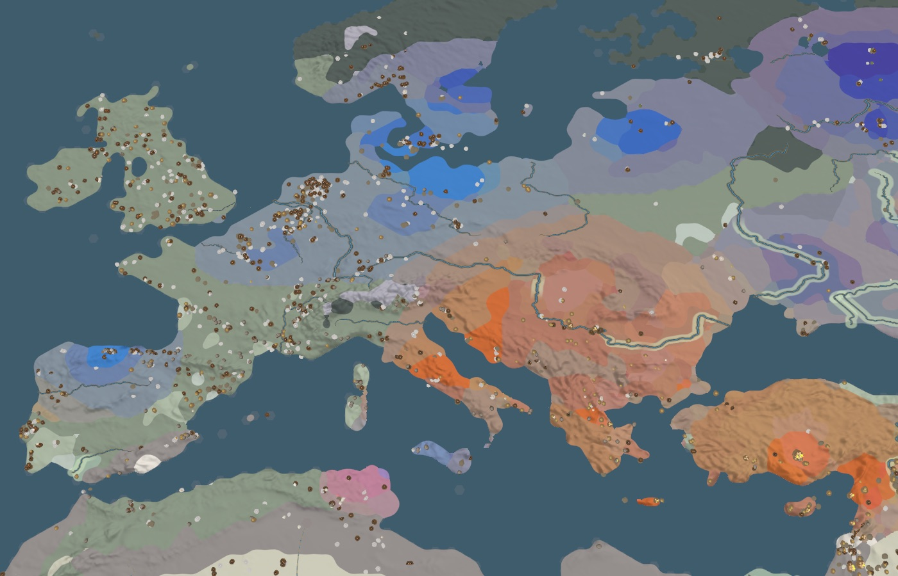
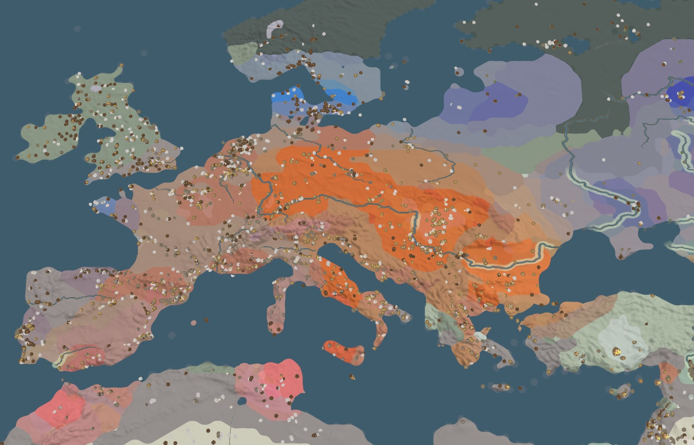
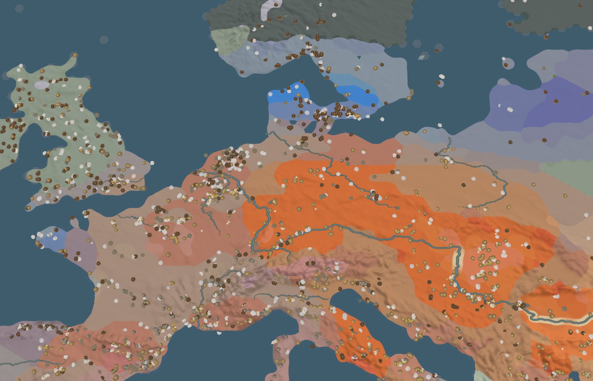
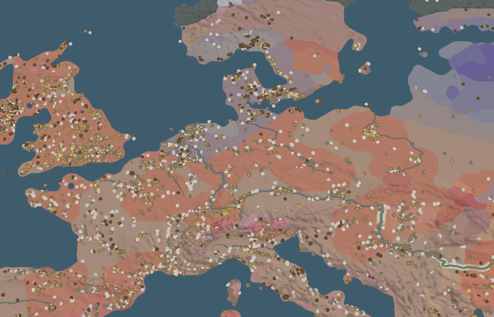
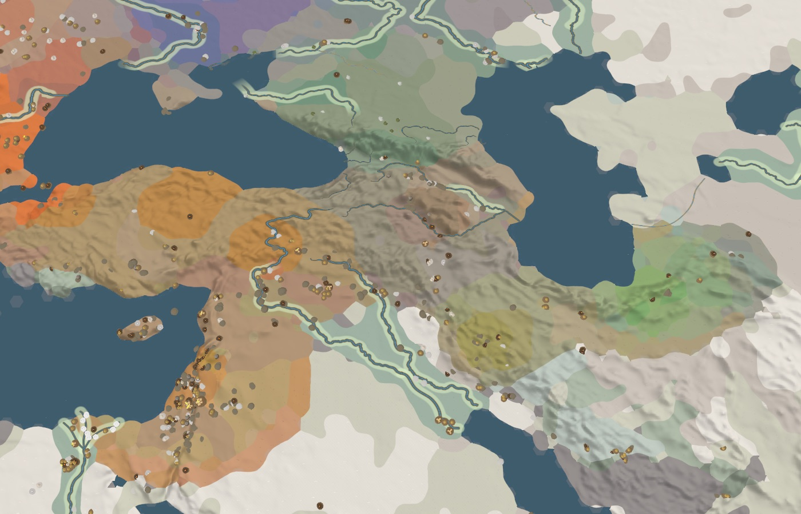
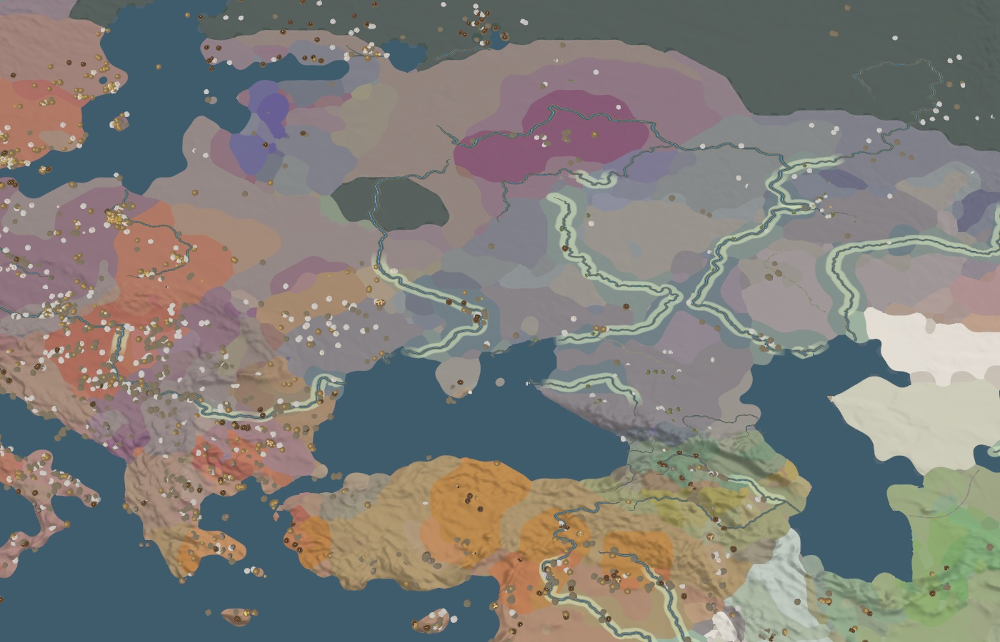
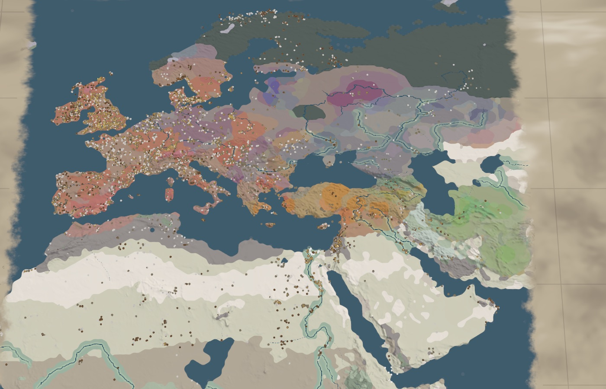

# Ancestry: four map moments

Material for the explainer page (`POSITIONING.md`). Each moment is one view of the `Ancestry` map
mode with the numbers behind it. The numbers are means of the per-genome qpAdm shares in
`data/ancestry/ancestry.csv.gz` (method and limits in `data/ancestry/SOURCES.md`). The colours
are shared ancestry, not peoples, languages or cultures.

Colours: western hunter-gatherer blue, eastern hunter-gatherer violet, Anatolian farmer orange,
Iranian/Caucasus green, Levantine yellow, North African pink. Pale colour means few genomes
nearby. Land with no genome within reach keeps its terrain colour, greyed.

The screenshots were taken headless from the full table on 2026-11-13:

```sh
neolith --screenshot out.png --mode ancestry --flat 1 --year <year> --lon <lon> --lat <lat> --dist <d> --pitch 80
```

## 1. The farmer front, 6000 and 5000 BCE

| 6000 BCE | 5000 BCE |
|---|---|
|  |  |

Anatolian-farmer ancestry is 99% of the 124 Anatolian genomes dated 7000 to 6000 BCE. In the
Balkans it goes from 39% (7000 to 6000 BCE, 29 genomes) to 85% (6000 to 5000 BCE, 74 genomes).
Central Europe is all hunter-gatherer before 6000 BCE (7 genomes) and 97% Anatolian farmer at
5500 to 5000 BCE (241 genomes, mostly Linear Pottery burials). The Baltic and Scandinavia stay
hunter-gatherer through 5000 BCE (75% western, 21% eastern).

## 2. The hunter-gatherer resurgence, 5000 to 3500 BCE

| 5000 BCE | 3500 BCE |
|---|---|
|  |  |

The farmers did not replace the hunter-gatherers outright. The western hunter-gatherer share
in central Europe rises every half-millennium after the first farmers: 2% (5500 to 5000 BCE),
16%, 20%, 26%, then 30% (3500 to 3000 BCE, 92 genomes). Globular Amphora burials average 25%
(38 genomes) and Funnel Beaker 29% (16). Britain and Ireland's first farmers already carry 22%
(143 genomes, 4000 to 3000 BCE). On the map the saturated orange of 5000 BCE turns salmon.

## 3. The Iranian/Caucasus gradient, 4000 BCE



From west to east the colour runs orange, olive, green. In 5000 to 4000 BCE the Iranian/Caucasus
share is 14% in Anatolia (6 genomes), 41% in the Caucasus (16) and 56% in Iran and the Zagros
(9). A millennium later it is 30%, 41% and 79% (53, 28 and 34 genomes). This is the gradient
that later reaches the steppe from the south.

## 4. The steppe gathering, 3000 BCE



What is later called steppe ancestry is a mixture of eastern hunter-gatherer and
Iranian/Caucasus ancestry. It is already there at Khvalynsk on the Volga (31 genomes, about
5200 to 4400 BCE: 77% eastern hunter-gatherer, 21% Iranian/Caucasus). By 4000 to 3000 BCE the
Don–Volga–Ural genomes average 50% eastern hunter-gatherer, 28% Iranian/Caucasus and 16%
Anatolian farmer (66 genomes). West of the steppe the mixture is rare inside the window: one
migrant in Hungary about 4250 BCE, then Yamnaya burials in Moldova, Hungary and Bulgaria from
about 3200 BCE. They are about 4% of the genomes west of 30°E dated 3250 to 3000 BCE, and 17%
in the following 250 years. The map ends at 3000 BCE, and the legend says the expansion itself
comes after.

## What is blank, and why



The mode draws only where a published genome lies within reach; nothing is filled in.

- **Egypt and Libya:** no genome in the table before 3000 BCE. Heat and humidity destroy DNA,
  and the first Egyptian genomes that pass the coverage floor are later.
- **Arabia and the Gulf:** none.
- **Mesopotamia:** 10 genomes in 7,000 years.
- **Russia north of 56°N:** 72 genomes over a very large area, so most of it is unknown.
- By contrast, Europe west of 30°E has 1,902 of the window's 2,619 genomes. The picture is
  sharpest where the sampling has been.
